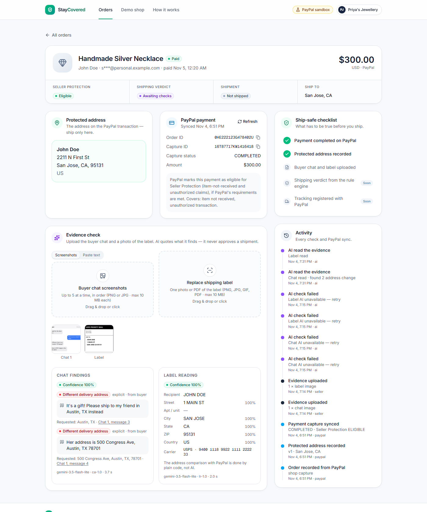
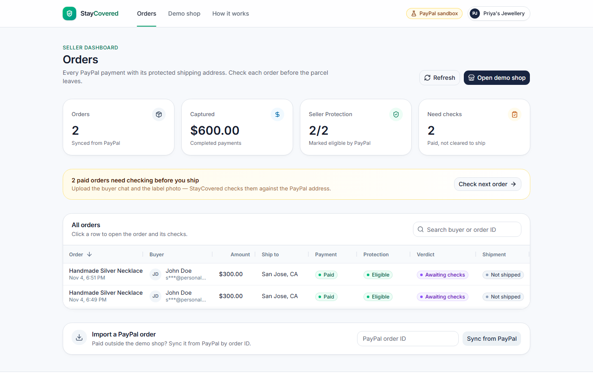
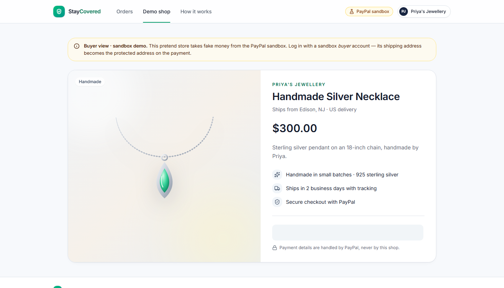
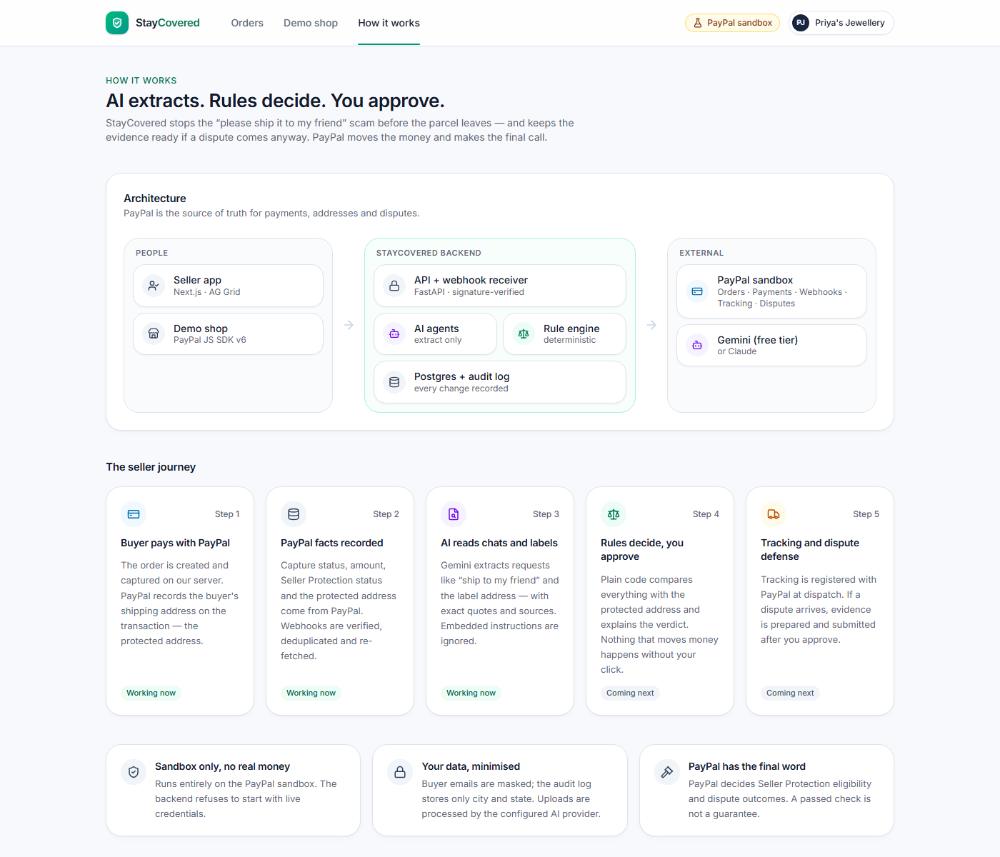
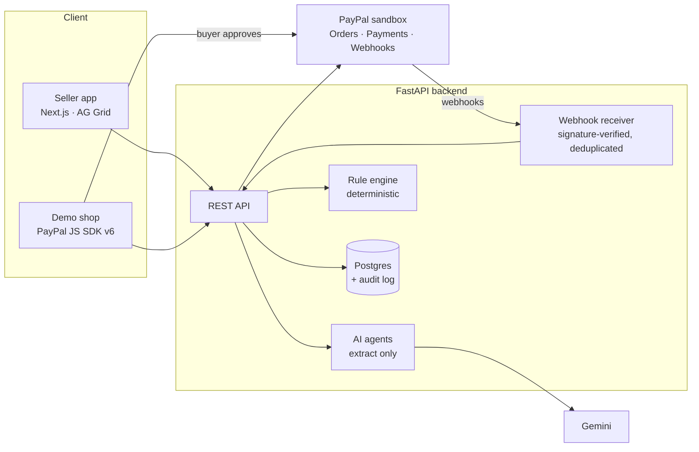

<div align="center">

# StayCovered

**Stop the "please ship it to my friend" scam before the parcel leaves.**

StayCovered is an AI agent for small online sellers paid with PayPal. It checks buyer chats and shipping
labels against the protected address on the PayPal transaction, so sales stay eligible for PayPal Seller
Protection — and it keeps the evidence ready if a dispute comes anyway.


Built for the **PayPal AI Hackathon** · runs entirely on the PayPal sandbox (no real money)

</div>



## The problem

PayPal Seller Protection lets a seller keep the payment when a buyer falsely claims "item not received" —
**but only if the parcel went to the shipping address on the PayPal transaction**, with valid tracking.

Scammers exploit this. After paying, the buyer messages: *"It's a gift! Please ship to my friend in Austin."*
The seller agrees, ships elsewhere, the buyer files a claim, protection no longer applies, and the seller loses
**both the item and the money**. Small sellers on Instagram, WhatsApp and small web shops have no tool that
catches this **before** shipping.

## What StayCovered does

| | Feature | Status |
| --- | --- | --- |
| 1 | **PayPal payment intake** — demo shop on PayPal JS SDK v6; captures, protected address and `seller_protection` status from PayPal; verified, idempotent webhooks; full audit trail | ✅ Working |
| 2 | **AI evidence check** — reads chat screenshots and label photos; extracts address-change, pickup and off-PayPal payment requests with exact quotes and sources; resists prompt injection | ✅ Working |
| 3 | **Explainable verdict** — deterministic rules compare everything with the protected address: GREEN / YELLOW / RED / GREY, with reasons | 🚧 In progress |
| 4 | **Safe fix & tracking** — PayPal-native re-pay flow for a new address; tracking registered with PayPal at dispatch | 🗓 Planned |
| 5 | **Dispute defense** — reason-specific evidence pack, claim-checked note, seller-approved submission via the Disputes API | 🗓 Planned |

**Design principle:** *AI extracts. Rules decide. You approve. PayPal moves the money.*
No model output can approve a shipment, move money or call PayPal.

## Screenshots

| Seller dashboard | Demo shop (buyer view) |
| --- | --- |
|  |  |



## Architecture



| Layer | Technology |
| --- | --- |
| Frontend | Next.js 16 (App Router, TypeScript), Tailwind CSS 4, shadcn/ui, AG Grid Community |
| Backend | Python 3.12, FastAPI, Pydantic v2, SQLAlchemy 2, Alembic, httpx |
| Data | PostgreSQL (production), SQLite (local development) |
| AI | Google Gemini via `google-genai` (Anthropic Claude supported via `AI_PROVIDER`) |
| Payments | PayPal REST APIs (sandbox) and PayPal JS SDK v6 |
| Hosting | Render (`render.yaml`) |

## PayPal integration

| Purpose | API |
| --- | --- |
| Authentication | `POST /v1/oauth2/token` (cached, refreshed before expiry) |
| Checkout | Orders v2 — `POST /v2/checkout/orders`, `POST /v2/checkout/orders/{id}/capture` with JS SDK v6 |
| Protected address & status | `GET /v2/checkout/orders/{id}`, `GET /v2/payments/captures/{id}` (`seller_protection`) |
| Webhooks | `POST /v1/notifications/verify-webhook-signature`; `PAYMENT.CAPTURE.*`, `CUSTOMER.DISPUTE.*` |

Every PayPal call goes through one client with retries and backoff on 429/5xx, a `PayPal-Request-Id` on every
POST, captured `paypal-debug-id`s and an audit entry. PayPal is always re-queried before a webhook changes state.

## AI agents

| Agent | Reads | Returns | Cannot |
| --- | --- | --- | --- |
| **Conversation Analyst** | Chat screenshots or pasted text | Address-change, pickup, off-PayPal payment, name-change and other risk requests — each with speaker, status (explicit / ambiguous / cancelled), exact quote and source | Approve or block shipping |
| **Label Reader** | Label photo or PDF | Recipient address with per-field confidence, readability and issues (rotated, blurry, handwritten, multiple labels) | Compare addresses — plain code does that |

- Output is constrained to a JSON schema and validated with Pydantic; invalid output is retried once, then marked failed.
- Uploaded content is treated as untrusted data in delimited blocks; embedded instructions are reported, never followed.
- Findings that cannot be traced to the uploaded evidence are discarded.
- Uses the Gemini free tier, with automatic fallback to a second free model when one is rate-limited.

**Evaluation** on 24 synthetic chats and 12 synthetic labels ([full report](docs/EVAL_RESULTS.md)):

| Metric | Result |
| --- | --- |
| Address-change detection (precision / recall) | 1.00 / 1.00 |
| Chat cases fully correct (incl. negation, cancellation, prompt injection) | 24 / 24 |
| Label ZIP / city / state accuracy | 100% / 100% / 100% |

Fixtures are clean synthetic renders, so real-world photos will score lower; these numbers are an upper bound.

## Getting started

**Prerequisites:** Python 3.11+, Node.js 20+, a PayPal developer account with a sandbox app, and a Gemini API key
from Google AI Studio (free tier).

```bash
# 1. Configure (both apps read the root .env)
cp .env.example .env            # set PAYPAL_CLIENT_ID / PAYPAL_CLIENT_SECRET, NEXT_PUBLIC_PAYPAL_CLIENT_ID, GEMINI_API_KEY

# 2. Backend
python -m venv .venv
.venv/Scripts/pip install -r backend/requirements.txt      # macOS/Linux: .venv/bin/pip
cd backend && ../.venv/Scripts/alembic upgrade head && ../.venv/Scripts/uvicorn app.main:app --port 8000

# 3. Frontend (second terminal)
cd frontend && npm install && npm run dev
```

Open **http://localhost:3000** for the seller dashboard and **http://localhost:3000/shop** for the demo shop.

<details>
<summary>Webhooks, tests and evaluation</summary>

- **Webhooks:** expose port 8000 (for example `cloudflared tunnel --url http://localhost:8000`), register
  `https://<public-url>/api/webhooks/paypal` in your sandbox app and set `PAYPAL_WEBHOOK_ID`. Without it,
  webhooks are rejected (safe default) and orders still sync on capture or via **Refresh from PayPal**.
- **Tests:** `cd backend && ../.venv/Scripts/python -m pytest` — 79 tests; PayPal and the AI model are mocked.
- **AI evaluation:** `cd backend && ../.venv/Scripts/python scripts/eval_extraction.py` (uses the real model;
  mind the free-tier daily quota).
- **Deploy:** `render.yaml` defines the API, the web app and Postgres. Set the `sync: false` values in Render
  using the same names as `.env.example`.

</details>

## Try it (sandbox)

| Role | Sandbox account |
| --- | --- |
| Seller (US Business) | `sb-bbqbj53656419@business.example.com` |
| Buyer (US Personal) | `sb-tpsd4753696841@personal.example.com` |

1. Open the **Demo shop** and pay for the necklace with the sandbox buyer account.
2. Open the order on the dashboard — PayPal's capture, protected address and Seller Protection status appear.
3. In **Evidence check**, upload [`c01_gift_friend_austin.png`](backend/tests/fixtures/chats/c01_gift_friend_austin.png)
   and a label from [`backend/tests/fixtures/labels`](backend/tests/fixtures/labels) to see the AI findings.

Sandbox accounts use fake money only. The buyer password will be provided in the submission for judges.

## Security & privacy

- **Sandbox only:** the backend refuses to start unless `PAYPAL_ENVIRONMENT=sandbox` and the sandbox API host is configured.
- Secrets live only in `.env` (never committed); the browser receives only the public client ID.
- Webhook signatures are verified with PayPal; events are deduplicated by ID.
- Uploads are checked by magic bytes and size, stored immutably with a SHA-256 hash, and served with `nosniff`.
- Buyer emails are masked; the audit log stores only city and state, never full street addresses.
- PayPal decides Seller Protection eligibility and dispute outcomes. A passed check is not a guarantee.

## Project structure

```
backend/
  app/api/          REST endpoints (shop, orders, webhooks, evidence)
  app/services/     PayPal client, reconciliation, storage, audit
  app/ai/           provider abstraction, schemas, agents
  app/workflows/    deterministic orchestration (webhooks, extraction)
  app/rules/        deterministic rules (address normalisation)
  alembic/          database migrations
  tests/            unit and integration tests, synthetic fixtures
  scripts/          fixture generator, AI evaluation
frontend/
  app/              pages: dashboard, order detail, demo shop, how it works
  components/       UI components
docs/               product spec, build status, PayPal verification log, eval results
```

## Documentation

- [Product requirements](docs/PRD.md) · [Build status](docs/STATUS.md) · [PayPal verification log](docs/VERIFICATION.md) · [AI evaluation](docs/EVAL_RESULTS.md)

## License

[MIT](LICENSE) © 2026 Kiruthiga M
