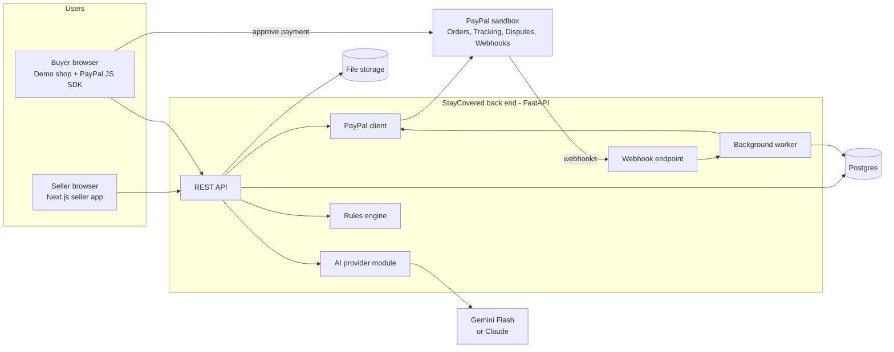
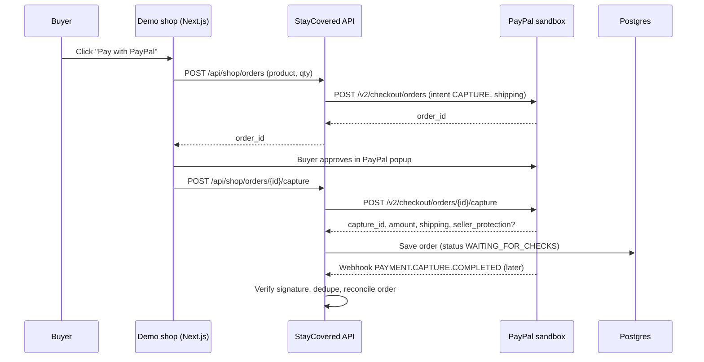
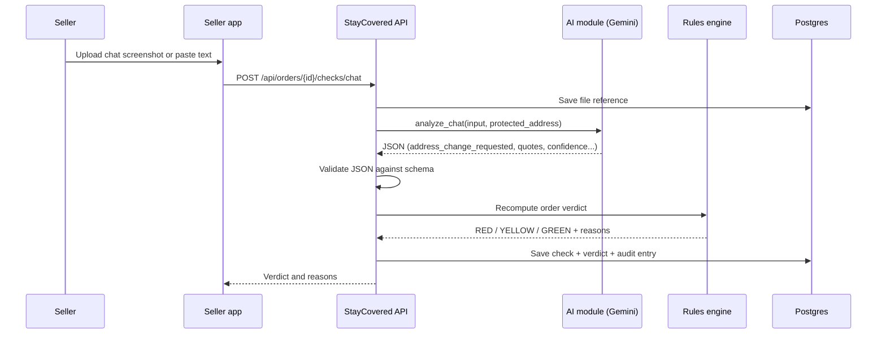
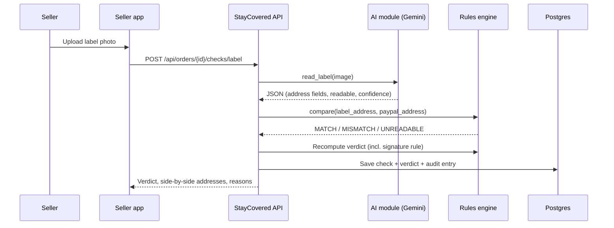
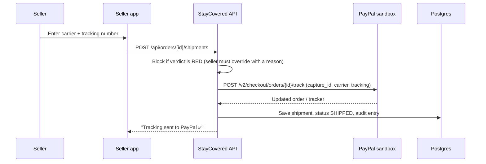
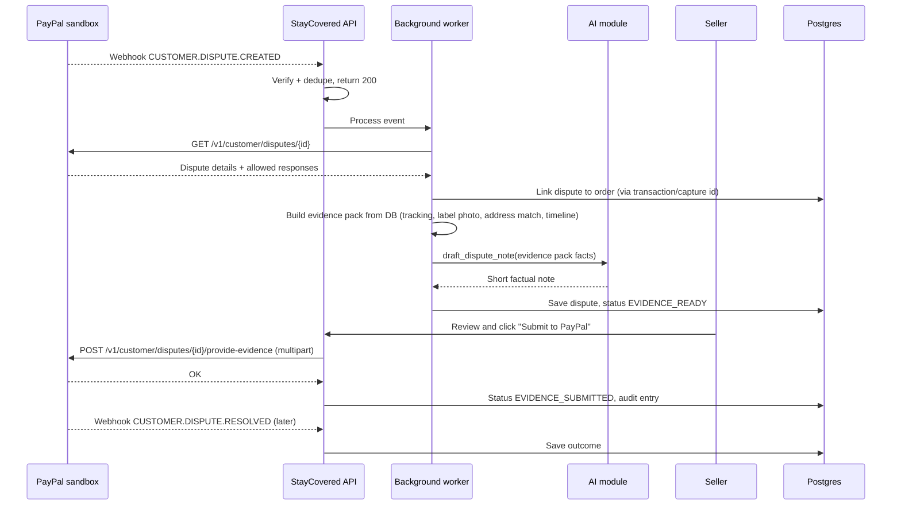
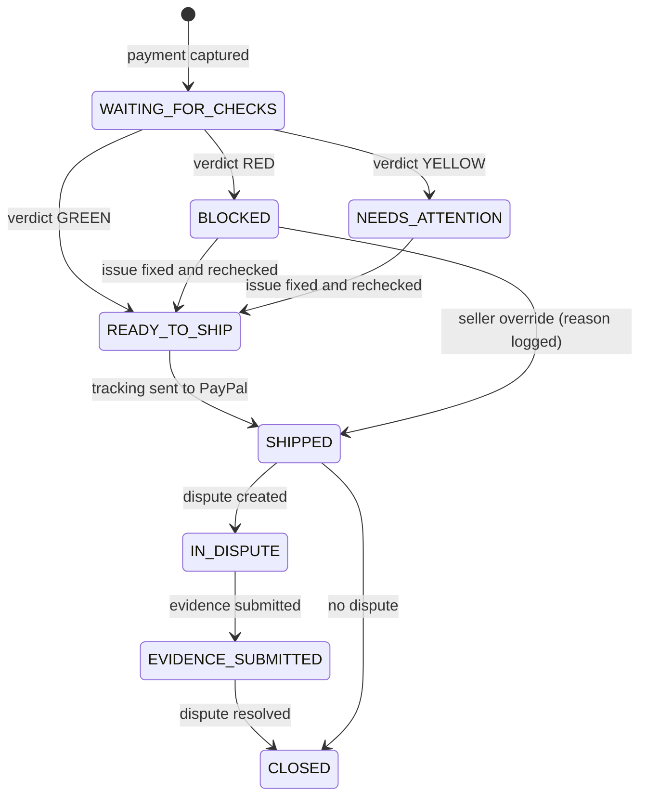

> **SUPERSEDED:** this is an earlier draft kept for history. `docs/PRD.md` and `CLAUDE.md` are authoritative; where they differ (verdict rules, env names, API paths, auto-submit), follow the PRD. Do not implement from this file.

# StayCovered: complete product and technical specification

> **For the AI reading this:** this is the full specification for a hackathon project. Read it end to end before writing code. Items marked **VERIFY** must be checked against PayPal's official documentation (or the PayPal AI Toolkit / sandbox MCP server) before you rely on them. Never invent API endpoints, fields, or webhook event names. If anything is unclear or contradictory, ask the developer before assuming.

---

## Part A: Purpose

### A1. One-line summary
**StayCovered is an AI agent that checks every parcel a small online seller ships, so the sale stays covered by PayPal Seller Protection, and answers PayPal disputes with proof automatically if they come anyway.**

### A2. Who it is for
- **Primary user: a small online seller** who sells through Instagram, WhatsApp, Facebook or a small website, gets paid with PayPal, and packs and posts parcels themselves. They have no operations team, no fraud team, and no Shopify-style tooling.
- **Persona: Priya**, who sells handmade jewellery to customers in the US. She gets 10–50 orders a month, replies to buyers on Instagram and WhatsApp, and ships through the post office. One lost $300 dispute wipes out a week of profit.

### A3. The problem in plain words
PayPal has a program called **Seller Protection**. If a buyer falsely says "I never received my item", PayPal lets the seller keep the money, **but only if the seller followed PayPal's rules**:

1. **Ship to the exact shipping address shown on the PayPal transaction.** If the parcel goes to a different address, or is redirected later, protection is lost.
2. **Have online, verifiable tracking** showing the parcel was shipped to (and ideally delivered at) that address.
3. **For high-value orders, get signature confirmation on delivery.** In the US the threshold is **$750 USD** including shipping and tax (**VERIFY** against PayPal's current Seller Protection policy; keep it as a config value).

Small sellers break these rules by accident, and scammers exploit that:

> A buyer pays $300 through PayPal. Their PayPal address is in New York. Then they message the seller: *"It's a gift! Please send it to my friend in Texas instead 😊"*. The seller is busy and kind, so they agree and ship to Texas. A week later the buyer tells PayPal "I never received it." PayPal sees the parcel went to Texas, not the address on the payment. Seller Protection doesn't apply. PayPal refunds the buyer, and **the seller loses both the item and the money.**

Other common traps: "my courier will pick it up", "pay me outside PayPal for a discount", forgetting tracking, and forgetting signature confirmation on expensive items.

### A4. What StayCovered does
Before each parcel goes out, StayCovered:
1. **Reads the PayPal order:** the protected shipping address, amount, and Seller Protection status (if PayPal exposes it).
2. **Reads the buyer's messages** (a screenshot or pasted text from WhatsApp, Instagram or email) and flags risky requests, such as shipping to another address, courier pickup, or paying outside PayPal.
3. **Reads a photo of the shipping label** and checks that the address matches the PayPal address.
4. **Checks the signature rule** for high-value orders.
5. **Gives one clear verdict:** 🟢 Safe to ship / 🟡 Needs attention / 🔴 Don't ship, with plain-language reasons.
6. **Sends the tracking number to PayPal** automatically after shipping.
7. **When a dispute arrives**, builds an evidence pack (tracking, label photo, address match, timeline), drafts a short factual note, and **submits it through PayPal's Disputes API**.

### A5. Why this matters to PayPal (the pitch to PayPal judges)
StayCovered is not just *using* PayPal. It strengthens PayPal's own business:

- **It protects PayPal's merchant base.** Small sellers who lose disputes they should have won lose trust in PayPal and may switch payment providers. StayCovered helps them actually get the protection PayPal promises.
- **It reduces disputes PayPal has to handle.** Scams stopped before shipping never become disputes. Disputes that do happen arrive with clean evidence, so they're quicker to resolve.
- **It makes PayPal's existing promise work in practice.** Seller Protection is one of PayPal's core trust features, but its rules are easy to break by accident. StayCovered turns those rules into an automatic checklist at the exact moment of shipping.
- **It uses PayPal's own building blocks:** Orders, order tracking, Disputes and webhooks. PayPal's developer advocates name disputes and order tracking as core platform capabilities.
- **It's agentic in a responsible way.** The AI reads messy human inputs (chats, photos) and takes real actions in PayPal (adding tracking, submitting evidence), while plain code makes every money-related decision.

### A6. How the idea was chosen
PayPal's developer advocates advised starting from a real problem, then mapping it to PayPal capabilities. We looked for a problem that:
- hurts small businesses in a measurable way (lost items plus lost money),
- PayPal already cares about (Seller Protection, disputes),
- needs AI for something rules alone can't do (understanding casual chat, reading label photos),
- needs little data, and can be built and demoed in about 9 days.

Existing tools were checked: dispute automation tools (such as Chargeflow) act **after** a dispute is filed; Shopify shows a PayPal Seller Protection badge, but only inside Shopify. We found no tool that checks a small seller's chats and labels **before shipping** to keep Seller Protection intact. (A small app could exist that we missed; don't claim "first ever" in the pitch.)

---

## Part B: Hackathon constraints (non-negotiable)

- **Deadline:** Nov 12, 2026, 12:00 PM PT (1:30 AM IST, Nov 13). Finish a day early.
- **Hard rule:** the project must meaningfully use both PayPal and AI, and **PayPal must be central**. A PayPal button bolted onto an unrelated app is not enough.
- **Free PayPal sandbox only.** No live credentials, no real money.
- **Sandbox accounts must be US:** one US Business account (the seller) and one US Personal account (the buyer), in the same country. Do not use Indian (IN) accounts: PayPal doesn't offer domestic payments within India, and our rules follow PayPal's US Seller Protection policy.
- **Submission needs:** a working hosted demo or clear run instructions; a public GitHub repo with an **MIT license** visible in the repo's About section; a demo video under 3 minutes; a text description; and a list of AI tools used and how.
- **Judging (equal weight):** Technological Implementation, Design (complete product experience), Potential Impact, Innovation, Presentation.
- **Any AI model is allowed.** We use Gemini Flash (free tier) behind a swappable interface.

---

## Part C: The business workflow (end to end, in plain words)

1. **Buyer pays.** A buyer buys from the seller's shop page and pays with PayPal. PayPal records the buyer's shipping address on the transaction.
2. **StayCovered picks up the order.** PayPal notifies StayCovered (webhook). StayCovered saves the order with the protected address and amount. Status: **Waiting for checks.**
3. **Seller checks the buyer's messages.** The seller uploads a screenshot of the chat with the buyer, or pastes the text. The AI flags any request to ship elsewhere, use a courier pickup, or pay outside PayPal.
4. **Seller checks the label.** Before posting, the seller photographs the shipping label. The AI reads the address; plain code compares it with the PayPal address.
5. **Verdict.** StayCovered shows 🟢 / 🟡 / 🔴 with reasons, for example: *"🔴 Don't ship: the buyer asked to ship to Austin, TX. Shipping anywhere other than the New York address on the PayPal payment cancels your Seller Protection."*
6. **Seller ships correctly** and enters the carrier and tracking number. StayCovered sends the tracking to PayPal. Status: **Shipped, tracking on PayPal.**
7. **If the buyer opens a dispute**, PayPal notifies StayCovered. StayCovered builds the evidence pack, drafts a note, shows it to the seller, and (on the seller's click) submits it to PayPal. Status: **Evidence submitted.**
8. **Resolution.** PayPal resolves the dispute; StayCovered records the outcome.

Everything is logged in an audit timeline per order.

---

## Part D: System architecture

### D1. Components

| Component | Technology | Responsibility |
| --- | --- | --- |
| **Seller web app** | Next.js (App Router, TypeScript), Tailwind | Dashboard, order detail, chat and label checks, tracking entry, dispute screens |
| **Demo buyer shop** | Next.js page + PayPal JS SDK | Lets a sandbox buyer place a real sandbox order (needed for the demo) |
| **Back end API** | FastAPI (Python 3.11+) | Business logic, PayPal calls, AI calls, webhooks |
| **PayPal client module** | Python (httpx) | OAuth token handling, Orders, tracking, Disputes, webhook signature verification |
| **AI provider module** | Python | `analyze_chat`, `read_label`, `draft_dispute_note`; Gemini Flash by default, switchable to Claude via env var |
| **Rules engine** | Python (plain code) | Address normalization and matching, signature rule, final verdict |
| **Background worker** | FastAPI background tasks (or Render worker) | Process webhooks asynchronously, retries |
| **Database** | Postgres (SQLAlchemy + Alembic) | Orders, checks, shipments, disputes, webhook events, audit log |
| **File storage** | Local disk / Render disk | Uploaded chat screenshots and label photos |
| **PayPal sandbox** | PayPal REST APIs | Orders, tracking, Disputes, webhooks |
| **AI service** | Google AI Studio (Gemini Flash) | Reading chats and labels, drafting notes |
| **Hosting** | Render | Web services + managed Postgres (use the hackathon's $50 Render credits) |

### D2. Architecture diagram



### D3. Key design principles
1. **AI only reads and writes words.** It never decides money matters and never calls PayPal directly. Plain code makes every verdict and every PayPal call.
2. **Every AI output is structured JSON, validated by schema.** If validation fails or confidence is low, show "Couldn't verify, please check manually" instead of guessing.
3. **PayPal is the source of truth** for addresses, amounts and dispute states. Never send model-generated values to PayPal without validation.
4. **Webhooks are verified and idempotent.**
5. **Everything is logged** in an audit trail.
6. **The seller stays in control:** submitting dispute evidence requires the seller's click (optionally "auto-submit" in settings for the demo).

---

## Part E: Technical flows (step by step)

### E1. Setup (one time)
1. Create a PayPal developer account at developer.paypal.com.
2. In **Sandbox → Testing Tools → Sandbox Accounts**, create:
   - a **US Business** account (the seller),
   - a **US Personal** account (the buyer) with a US address and a balance.
3. In **Apps & Credentials (Sandbox)**, create an app linked to the **US Business** account. Copy the client ID and secret into `.env`.
4. In the app's features, turn on **Disputes** (and transaction search if shown), click **Save**, and wait up to 10 minutes.
5. Register a webhook URL (ngrok/Cloudflare tunnel locally, the Render URL in production) and subscribe to the events in E6. Store the **webhook ID** in `.env` (needed for signature verification).
6. Get a free Gemini API key from Google AI Studio and put it in `.env`.

### E2. Buyer checkout and order sync



Notes:
- Capture on the server. Store `paypal_order_id`, `capture_id`, amount, currency, shipping address (as returned by PayPal) and the raw response.
- **VERIFY:** the capture response may include a `seller_protection` object with a status such as `ELIGIBLE`, `PARTIALLY_ELIGIBLE` or `NOT_ELIGIBLE`. If present, store and display it. If not, display "Check in PayPal" and don't fake it.
- Orders created outside the demo shop can be synced by order ID (`GET /v2/checkout/orders/{id}`), or via transaction search as a stretch goal.

### E3. Chat check



### E4. Label check



### E5. Shipping and tracking



- **VERIFY** the exact request body for adding tracking, which order states allow it, and the carrier code format.
- Use a `PayPal-Request-Id` header for idempotency where supported.

### E6. Webhooks

Subscribe to (**VERIFY** names in PayPal's webhook event list):
- `PAYMENT.CAPTURE.COMPLETED`
- `CUSTOMER.DISPUTE.CREATED`
- `CUSTOMER.DISPUTE.UPDATED`
- `CUSTOMER.DISPUTE.RESOLVED`

Handling:
1. Receive the POST at `/api/webhooks/paypal`.
2. Verify with `POST /v1/notifications/verify-webhook-signature` (using the stored webhook ID and the transmission headers).
3. Look up `paypal_event_id` in `webhook_events`. If already processed, return 200 and stop (idempotency; PayPal retries failed deliveries many times over several days).
4. Store the event, return **200 quickly**, and process it in the background.

### E7. Dispute handling



Notes:
- Only call actions that the dispute details list as allowed for its current stage.
- **VERIFY** the multipart format for provide-evidence, the evidence types (e.g. proof of fulfillment with carrier and tracking), and the file size/type limits.
- **Sandbox test disputes:** merchants can create disputes in the sandbox for testing. **VERIFY** the exact method and document it in the README so judges can reproduce the demo.
- Alternative branch (for orders with no valid evidence): `POST /v1/customer/disputes/{id}/accept-claim`, offered to the seller as an option, never automatic.

### E8. Order state machine



---

## Part F: PayPal API reference for this project (sandbox)

Base URL: `https://api-m.sandbox.paypal.com`. Credentials only in env vars; the secret must never reach the front end or the repo.

| Purpose | Endpoint |
| --- | --- |
| Access token | `POST /v1/oauth2/token` (client credentials; cache and refresh) |
| Create order | `POST /v2/checkout/orders` (intent CAPTURE, with shipping) |
| Capture order | `POST /v2/checkout/orders/{id}/capture` |
| Order details | `GET /v2/checkout/orders/{id}` |
| Add tracking | `POST /v2/checkout/orders/{id}/track` (**VERIFY** body) |
| List disputes | `GET /v1/customer/disputes` |
| Dispute details | `GET /v1/customer/disputes/{id}` |
| Provide evidence | `POST /v1/customer/disputes/{id}/provide-evidence` (**VERIFY** multipart format) |
| Accept claim (optional) | `POST /v1/customer/disputes/{id}/accept-claim` |
| Verify webhook | `POST /v1/notifications/verify-webhook-signature` |

Client side: PayPal JavaScript SDK on the demo shop page (v6 is now available; **VERIFY** which version's docs you follow and stay consistent).

Testing:
- US Business + US Personal sandbox accounts.
- Use the sandbox **Event Logs** (API calls, errors) to debug.
- Test unhappy paths: declined payment, address mismatch, duplicate webhook, dispute on an order without tracking, expired access token.
- Sandbox access tokens from the AI Toolkit setup expire roughly every 9 hours; the app should refresh its own token automatically.

---

## Part G: AI design

### G1. Model
- Default: **Gemini Flash via Google AI Studio (free tier).** Keep usage small (one call per check).
- Switchable to Claude by setting `AI_PROVIDER=claude` and an API key. All prompts and schemas live in one module.

### G2. Task 1: `analyze_chat`
Input: a chat screenshot or pasted text, plus the protected PayPal address for context.
Output JSON:
```json
{
  "address_change_requested": true,
  "requested_address_text": "string or null",
  "pickup_or_courier_requested": false,
  "off_platform_payment_requested": false,
  "other_risk_signals": ["string"],
  "evidence_quotes": ["short exact phrases from the chat"],
  "language": "en",
  "confidence": 0.0
}
```
Prompt guidance: detect intent even when phrased casually or indirectly ("can my cousin collect it?", "send to my office instead", "it's a surprise, ship to her place"). Quote the exact phrases. Don't invent content not in the input.

### G3. Task 2: `read_label`
Input: a label photo (printed or handwritten).
Output JSON:
```json
{
  "recipient_name": "string or null",
  "address_line1": "string or null",
  "address_line2": "string or null",
  "city": "string or null",
  "state": "string or null",
  "postal_code": "string or null",
  "country": "string or null",
  "tracking_number_visible": "string or null",
  "readable": true,
  "confidence": 0.0
}
```

### G4. Task 3: `draft_dispute_note`
Input: the evidence pack (facts from the database only).
Output: a short, factual note under 1,000 characters, stating the shipment date, carrier, tracking number, and that the parcel was shipped to the address on the PayPal transaction. No claims beyond the evidence.

### G5. Guardrails
- Validate every response with Pydantic. On failure, retry once, then mark the check UNVERIFIED.
- Confidence below a threshold (e.g. 0.7) → YELLOW "check manually".
- Model text never goes into amounts, addresses or decisions sent to PayPal.

---

## Part H: Decision rules (plain code, not AI)

**Address match:**
- Normalize both addresses: lowercase, strip punctuation, expand common abbreviations (St/Street, Ave/Avenue, Apt/Unit/#), trim spaces.
- Postal code must match exactly (first 5 digits for US ZIP).
- City and state must match after normalization.
- Street line must match closely (small typo distance allowed, e.g. Levenshtein ratio ≥ 0.85).
- Result: `MATCH`, `MISMATCH` or `UNREADABLE`.

**Signature rule:**
- If the order total ≥ `SIGNATURE_THRESHOLD_USD` (default 750), require the seller to confirm "signature confirmation added" before GREEN.

**Verdict:**
- 🔴 **RED (Don't ship):** label MISMATCH; or chat shows an address change, courier pickup, or off-platform payment request.
- 🟡 **YELLOW (Needs attention):** label UNREADABLE; low AI confidence; signature required but not confirmed; no label check yet.
- 🟢 **GREEN (Safe to ship):** label MATCH, no risky chat signals (or no chat provided and the seller confirms there were no requests), and the signature requirement satisfied.

Each verdict comes with plain-language reasons shown to the seller.

---

## Part I: Data model (minimum)

| Table | Key columns |
| --- | --- |
| `orders` | id, paypal_order_id (unique), capture_id, amount, currency, shipping_address (JSON), seller_protection_status, verdict, status, raw (JSON), created_at |
| `checks` | id, order_id, type (chat \| label), file_path, input_text, ai_output (JSON), result, confidence, created_at |
| `shipments` | id, order_id, carrier, tracking_number, paypal_response (JSON), override_reason, created_at |
| `disputes` | id, paypal_dispute_id (unique), order_id, reason, stage, status, evidence_note, evidence_submitted_at, outcome, raw (JSON) |
| `webhook_events` | id, paypal_event_id (unique), event_type, verified, received_at, processed_at, raw (JSON) |
| `audit_log` | id, order_id, actor (system \| seller \| ai \| paypal), action, details (JSON), created_at |
| `settings` | signature_threshold_usd, ai_provider, auto_submit_evidence (bool) |

---

## Part J: Back-end API endpoints

| Method | Path | Purpose |
| --- | --- | --- |
| POST | `/api/shop/orders` | Create a PayPal order for the demo shop |
| POST | `/api/shop/orders/{id}/capture` | Capture and save the order |
| GET | `/api/orders` | List orders with verdict badges |
| GET | `/api/orders/{id}` | Order detail, checks, timeline |
| POST | `/api/orders/sync` | Sync an order by PayPal order ID |
| POST | `/api/orders/{id}/checks/chat` | Run the chat check (file or text) |
| POST | `/api/orders/{id}/checks/label` | Run the label check (image) |
| POST | `/api/orders/{id}/confirm-signature` | Seller confirms signature confirmation added |
| POST | `/api/orders/{id}/shipments` | Save tracking and send it to PayPal |
| GET | `/api/disputes` | List disputes |
| GET | `/api/disputes/{id}` | Dispute detail and evidence pack |
| POST | `/api/disputes/{id}/submit-evidence` | Submit evidence to PayPal |
| POST | `/api/webhooks/paypal` | PayPal webhook receiver |
| GET | `/api/health` | Health check |

---

## Part K: Screens

1. **Dashboard:** list of orders with 🟢🟡🔴 badges, amounts, buyer names; a disputes panel with statuses.
2. **Order detail:**
   - PayPal protected address and amount; Seller Protection status (if available).
   - Checklist: chat checked, label matches, signature (if needed), tracking sent.
   - Chat check card: upload screenshot or paste text; shows flagged quotes.
   - Label check card: upload photo; shows the label address and PayPal address side by side with differences highlighted.
   - Verdict banner with reasons.
   - Tracking form (disabled or warning when RED).
   - Timeline (audit log).
3. **Dispute detail:** reason, stage, evidence pack preview (tracking, label photo, address match), editable AI note, **Submit to PayPal** button, result.
4. **Demo shop:** one product (e.g. a $300 necklace) with PayPal checkout.
5. **How it works:** a simple architecture diagram and explanation (helps the judges).

Design: clean, calm, mobile-friendly; the verdict must be understandable at a glance.

---

## Part L: Security and reliability

- Secrets only in env vars; commit `.env.example`, never `.env`.
- Verify every webhook signature; store and dedupe event IDs.
- Return 200 to webhooks quickly; process in the background.
- Use `PayPal-Request-Id` on PayPal POST calls where supported.
- Refresh the PayPal access token automatically before expiry.
- Log every PayPal call (endpoint, status, debug ID) in the audit log; never log secrets or full card data.
- Validate uploaded files (type, size); store outside the web root.
- Handle PayPal and AI errors with clear messages; never crash the page.

---

## Part M: Testing and demo

### M1. Tests
- Unit tests: address normalization and matching (exact, typo, different city, different ZIP, unreadable), signature rule, verdict combinations.
- AI checks: a small sample set (10–30 chats and labels), including tricky phrasings, with expected results; show the accuracy in the README.
- End-to-end sandbox script: create order → capture → chat check → label check → add tracking → create sandbox dispute → submit evidence.

### M2. Demo video storyboard (under 3 minutes)
| Time | Scene |
| --- | --- |
| 0:00–0:20 | The problem: "Ship it to my friend" scam; seller loses item and money |
| 0:20–0:40 | Buyer pays $300 in the demo shop (PayPal sandbox); order appears in StayCovered |
| 0:40–1:10 | Seller uploads the chat screenshot → 🔴 "Don't ship" with the quoted phrase |
| 1:10–1:35 | Seller uploads a label with the wrong address → 🔴; then the correct one → 🟢 |
| 1:35–1:55 | Tracking entered → "Tracking sent to PayPal ✅" (show the sandbox order) |
| 1:55–2:30 | Fake "item not received" dispute arrives → evidence pack → submitted to PayPal |
| 2:30–2:50 | Architecture: "AI reads chats and labels. Plain code decides. PayPal moves the money." |
| 2:50–2:58 | Close: why it matters for small sellers and for PayPal |

---

## Part N: Repository deliverables

- `LICENSE` (MIT) at the root.
- `README.md`: hosted demo URL and video link at the top; the problem; a 90-second "try it" path; sandbox account setup (US accounts); how to create a sandbox dispute; local run steps; architecture diagram; table of PayPal APIs used; AI tools used and how; known limits.
- `.env.example`: `PAYPAL_CLIENT_ID`, `PAYPAL_CLIENT_SECRET`, `PAYPAL_WEBHOOK_ID`, `PAYPAL_BASE_URL`, `AI_PROVIDER`, `GEMINI_API_KEY`, `ANTHROPIC_API_KEY` (optional), `DATABASE_URL`, `SIGNATURE_THRESHOLD_USD`, `FILE_STORAGE_PATH`.

---

## Part O: Build order (about 9 days)

1. Repo skeleton (Next.js + FastAPI + Postgres), MIT license, `.env.example`; deploy a "hello world" to Render early.
2. PayPal auth + demo shop checkout (create/capture) + save orders.
3. Webhook endpoint with signature verification and idempotency.
4. Dashboard + order detail + address display + signature rule.
5. AI provider module + `read_label` + address matching + verdict.
6. `analyze_chat` + chat check UI.
7. Add tracking to PayPal.
8. Disputes: sync, evidence pack, AI note, provide-evidence submission; sandbox dispute creation documented.
9. Audit timeline, polish, tests, README, end-to-end run on the hosted URL, video.
10. Stretch only after all of the above: WhatsApp Cloud API test-number intake; an eval page.

After each step, report what you built, what you verified against PayPal docs, and anything uncertain.

---

## Part P: How to work with the developer

- Ask before making assumptions that change scope, cost or architecture.
- Prefer simple, readable code; this is a 9-day hackathon.
- When a PayPal detail is uncertain, check the docs or the sandbox, then report what you found.
- Keep the demo story in Part C working end to end at all times.
